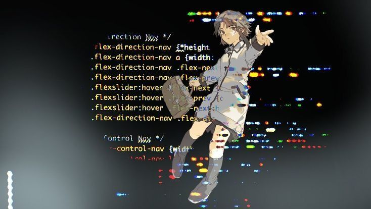

  <h1>hey, i'm aryan</h1>
  
writing code, training models, figuring things out as i go.

---

### about me

just a dev who likes building cool stuff and messing around with machine learning.

mostly working with **python**, **java**, and **pytorch** lately. when i'm not training models or debugging something that worked five minutes ago, i'm probably deep into backend architecture or grinding dsa.

no grand ten-year plan—just trying to write clean code and make things that actually work.

 

---

### stack

  

